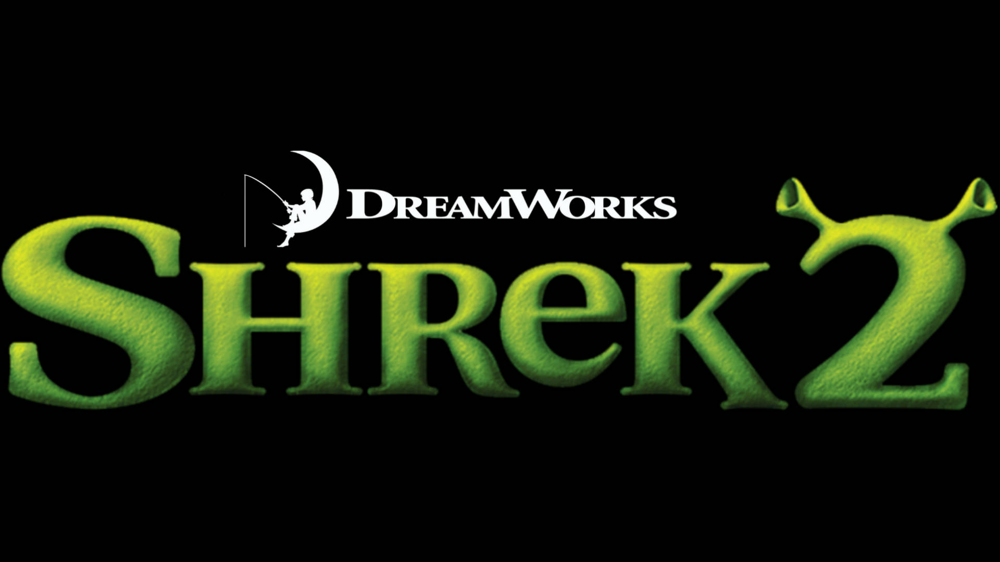

<h1 align="center">Shrek 2 PC — Unified Patch</h1>

<b>English</b> · <a href="README.ru.md">Русский</a> · <a href="https://kam0n4ik.github.io/Shrek-2-PC-Unified-Patch/">Website</a> · <a href="https://github.com/kam0n4ik/Shrek-2-PC-Unified-Patch/releases/latest">Download</a>

An unofficial patch for the 2004 PC game **Shrek 2** (KnowWonder / Activision, Unreal Engine 2): widescreen, modern resolutions, windowed mode, VSync, crash fixes, intro skip and an optional unlock of the developers' debug menu. It comes as a single installer that verifies every file and can roll back to the originals.

## Features

**Display**
- Resolutions 1280×720, 1366×768, 1600×900, 1920×1080, 2048×1152 and 2560×1440 in *Options → Video*. The original 4:3 modes are still there.
- Fullscreen or windowed mode, and VSync on/off.
- A confirmation dialog for new video settings. If you don't confirm within 15 seconds, the old settings come back.
- Hor+ camera: the vertical field of view stays the same and the horizontal one gets wider.
- The HUD, menus, subtitles, icons and loading/saving indicators stay at their 4:3 proportions, centred on the screen. Click areas and the cursor match the new layout.
- Full-screen Bink movies keep their aspect ratio (pillarboxed, no cropping). The 1024 versions of the movies are used when the resolution allows.

**Fixes**
- **Crash when switching VSync to "Off"** (GPF in `GUIComboBox.TextChanged`). A `bVisible` assignment in `SHGame.u` was encoded with the wrong bytecode form for a bool assignment, so it read a garbage pointer.
- **Alt+F4 did nothing in fullscreen.** The fullscreen window has no system menu, so Windows discarded `SC_CLOSE`. Alt+F4 now sends `WM_CLOSE`, and the game exits normally.
- Stripes, wrong colours and partial output in Bink movies, plus a write past the end of the decoder's temporary buffer.
- Settings tabs going off the left edge of the screen at high resolutions.
- Only the first of four landing animations was being checked.
- Array upper-bound errors in game managers and utilities.

**Quality of life**
- **Intro skip (1.5).** The DreamWorks / Activision / KnowWonder logo movies no longer play. The game goes straight to the main menu, and the main-menu storybook opens about 4× faster.
- **Developer menu (1.6, optional).** A checkbox in the installer binds:
  - `F9` to `ToggleDebugMode`, which turns developer mode on and off;
  - `F10` to `ShowDevMenu`, which opens the original **Dev Menu**: load any map, use bookmark teleports, pick the story state (GameState).

## Installation

1. Close the game.
2. Download `Shrek2VideoPatch-1.6.exe` from [Releases](https://github.com/kam0n4ik/Shrek-2-PC-Unified-Patch/releases/latest) and run it.
3. Point it at the game's `System` folder and click **Установить патч** (*Install patch*). The installer window is in Russian. If you want F9/F10, tick **Разблокировать меню разработчиков** (*Unlock developer menu*) first.
4. Start the game, open *Options → Video*, choose a resolution, apply and confirm.

**Восстановить оригинал** (*Restore original*) puts back every file from `System\Shrek2VideoPatchBackup` and removes the F9/F10 bindings.

The installer checks the SHA-256 of every file before and after patching. A file that doesn't match a known version is reported, and nothing is changed. Earlier versions 1.0–1.5 of the patch are upgraded in place, using the original backup.

> The installer is built and tested on the **Russian retail PC release**. Other language builds have different `.int` files and will most likely be rejected without changes. No game files are included: the installer only contains binary diffs and applies them to your own copy of the game.

Command-line options: `--system <path>`, `--check`, `--restore`, `--devmenu`, `--profile <User.ini>`, `--report <file>`.

## Cut content found in the files

- **225 voiced dialogue lines that nothing ever plays.** They are in `HpDialog.int` and `AllDialog.uax`.
  - 149 of them are whole families of combat barks: peasants, knights, bandits, elves, Mongo, cats. That looks like an abandoned combat chatter system.
  - 76 are story lines:
    - a Fairy Godmother **potion TV commercial** ("limited edition");
    - a **FGM drive-thru** scene with Shrek and Donkey;
    - Donkey's HUD tutorial for health, coins and double jump;
    - a giant pumpkin and "Peter the Pumpkin Eater";
    - Puss in Boots talking about fire vents and lasers, the route through the dwarves' caves and the well on Jack and Jill's hill;
    - Donkey saying "This is all like some kind of computer game!".
- **86 dialogue sounds** with no text, never referenced.
- **`Book_StoryBook.unr`.** Nothing in the game links to this map: it has the storybook, Shrek and 15 cameras. It looks like an early prototype of the storybook cutscenes.
- **Developer tools.** The KWGame **Dev Menu** (map loader, bookmarks, GameState), a UWindows debug menu bar (`SHDebugRootWindow`, F2), and cheat commands: `FraserIsGod` (god mode), `AddCoins`, `AddPotions`, `Addposters`, `GameSpeedUp/Down`, `FreeCam`, `ToggleHud` and more.

The full audit is in [`source/Audit`](source/Audit).

## Repository layout

| Path | Contents |
|---|---|
| `installer/PatchInstaller.cs` | Installer source (C#, .NET Framework 4, WinForms) |
| `installer/patch.json.gz` | Patch manifest: hashes and binary diffs, embedded in the exe |
| `source/` | Build and verification scripts for every release (Python), evidence and the code audit |

Build: `csc /target:winexe /resource:patch.json.gz,patch.json.gz /reference:System.Web.Extensions.dll /reference:System.Windows.Forms.dll /reference:System.Drawing.dll PatchInstaller.cs`

Decompilation tools used: [UE-Explorer](https://github.com/UE-Explorer/UE-Explorer), [Unreal-Library](https://github.com/EliotVU/Unreal-Library).

---

Unofficial fan project, not affiliated with DreamWorks Animation, Activision or KnowWonder. Shrek is a trademark of DreamWorks Animation L.L.C.
