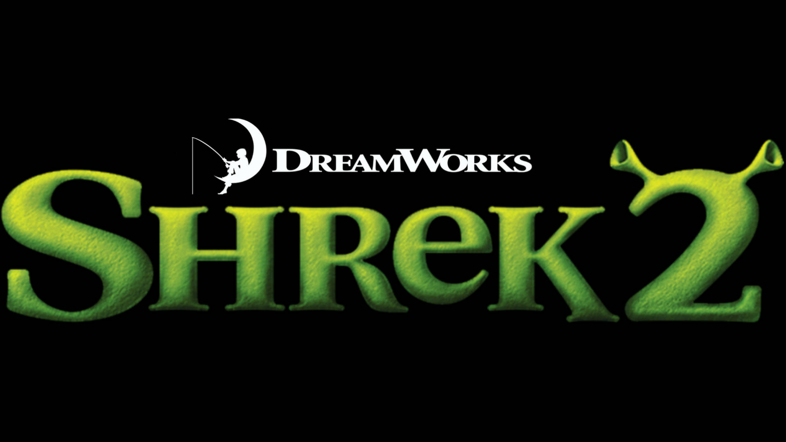

<h1 align="center">Shrek 2 (2004) PC — единый патч</h1>

<a href="README.md">English</a> · <b>Русский</b> · <a href="https://kam0n4ik.github.io/Shrek-2-PC-Unified-Patch/ru/">Сайт</a> · <a href="https://github.com/kam0n4ik/Shrek-2-PC-Unified-Patch/releases/latest">Скачать</a>

> [!IMPORTANT]
> Патч для **оригинальной PC-игры 2004 года** (KnowWonder / Activision, Unreal Engine 2). **Не для ремастера 2026 года**, с ним он работать не будет.

Неофициальный патч для PC-версии **Шрек 2** 2004 года (KnowWonder / Activision, Unreal Engine 2). Он добавляет широкий экран, современные разрешения, оконный режим и VSync, исправляет вылеты, пропускает заставки и по желанию открывает меню разработчиков. Всё ставится одним установщиком. Он проверяет каждый файл и умеет вернуть оригиналы.

## Возможности

**Экран**
- Разрешения 1280×720, 1366×768, 1600×900, 1920×1080, 2048×1152 и 2560×1440 в «Настройки → Видео». Старые режимы 4:3 остаются.
- Полный экран или окно, VSync вкл./выкл.
- Подтверждение новых видеонастроек. Если не подтвердить за 15 секунд, вернутся прежние.
- Камера Hor+: вертикальный обзор не меняется, горизонтальный становится шире.
- HUD, меню, субтитры, иконки и индикаторы загрузки и сохранения сохраняют пропорции 4:3 и стоят по центру экрана. Области клика и курсор совпадают с новым положением.
- Bink-ролики сохраняют пропорции: по бокам чёрные поля, ничего не обрезается. При подходящем разрешении берутся версии роликов 1024.

**Исправления**
- **Вылет при выборе VSync «Выкл.»** (GPF в `GUIComboBox.TextChanged`). Присваивание `bVisible` в `SHGame.u` было записано в неправильной форме байткода для bool, и игра читала мусорный указатель.
- **Alt+F4 не закрывал игру в полноэкранном режиме.** У полноэкранного окна нет системного меню, поэтому Windows отбрасывала `SC_CLOSE`. Теперь Alt+F4 отправляет окну `WM_CLOSE`, и игра закрывается штатно.
- Полосы, неверные цвета и частичный вывод Bink-роликов, а также запись декодера за границу временного буфера.
- Вкладки настроек уезжали за левый край экрана на высоком разрешении.
- Из четырёх анимаций приземления проверялась только первая.
- Выход за верхнюю границу массивов в игровых менеджерах и утилитах.

**Удобство**
- **Пропуск заставок (1.5).** Ролики с логотипами DreamWorks, Activision и KnowWonder больше не показываются, игра сразу переходит к главному меню. Книга главного меню открывается примерно вчетверо быстрее.
- **Меню разработчиков (1.6, по желанию).** Галочка в установщике назначает две клавиши:
  - `F9` — `ToggleDebugMode`, включает и выключает режим разработчика;
  - `F10` — `ShowDevMenu`, открывает оригинальное **Dev Menu**: загрузка любого уровня, закладки-телепорты, выбор этапа сюжета (GameState).

## Установка

1. Закройте игру.
2. Скачайте `Shrek2VideoPatch-1.6.exe` со страницы [релизов](https://github.com/kam0n4ik/Shrek-2-PC-Unified-Patch/releases/latest) и запустите.
3. Укажите папку `System` игры и нажмите **Установить патч**. Если нужны F9/F10, перед этим отметьте **Разблокировать меню разработчиков**.
4. Запустите игру, откройте «Настройки → Видео», выберите разрешение, нажмите «Применить» и подтвердите.

**Восстановить оригинал** возвращает все файлы из `System\Shrek2VideoPatchBackup` и убирает клавиши F9/F10.

Установщик сверяет SHA-256 каждого файла до и после установки. Если какой-то файл не совпадает с известной версией, установщик сообщит об этом и ничего не изменит. Прежние версии патча 1.0–1.5 обновляются на месте по исходной резервной копии.

> Патч сделан и проверен на **русской лицензионной PC-версии**. У других языковых версий другие `.int`-файлы, и установщик, скорее всего, откажется их менять. Файлов игры в патче нет: в установщике только бинарные различия, которые накладываются на вашу копию игры.

Параметры командной строки: `--system <путь>`, `--check`, `--restore`, `--devmenu`, `--profile <User.ini>`, `--report <файл>`.

## Вырезанный контент в файлах игры

- **225 озвученных реплик, которые игра нигде не проигрывает.** Они лежат в `HpDialog.int` и `AllDialog.uax`.
  - 149 из них — целые семейства боевых выкриков: крестьяне, рыцари, бандиты, эльфы, Монго, коты. Похоже на заброшенную систему боевой болтовни.
  - 76 — сюжетные реплики:
    - **телереклама зелий** Феи-крёстной («ограниченная серия»);
    - сцена у **автокафе Феи** со Шреком и Ослом;
    - обучение от Осла: здоровье, монеты, двойной прыжок;
    - гигантская тыква и «Питер — пожиратель тыкв»;
    - Кот в сапогах про огненные вентиляции и лазеры, про путь через пещеры гномов и колодец на холме Джека и Джилл;
    - Осёл: «Всё это похоже на компьютерную игру!».
- **86 звуков диалогов** без текста, на них нет ни одной ссылки.
- **Карта `Book_StoryBook.unr`.** На неё нигде нет ссылок: на карте только книга, Шрек и 15 камер. Похоже на ранний прототип сцен-сказок.
- **Инструменты разработчиков.**
  - **Dev Menu** из KWGame: загрузчик карт, закладки, выбор GameState.
  - Отладочное меню UWindows (`SHDebugRootWindow`, F2).
  - Чит-команды: `FraserIsGod` (бессмертие), `AddCoins`, `AddPotions`, `Addposters`, `GameSpeedUp/Down`, `FreeCam`, `ToggleHud` и другие.

Полный аудит лежит в [`source/Audit`](source/Audit).

## Состав репозитория

| Путь | Что внутри |
|---|---|
| `installer/PatchInstaller.cs` | Исходник установщика (C#, .NET Framework 4, WinForms) |
| `installer/patch.json.gz` | Манифест патча: хэши и бинарные различия, встраивается в exe |
| `installer/README.ru.txt` | Подробное описание всех версий |
| `source/` | Скрипты сборки и проверки каждого релиза (Python), отчёты проверок и аудит кода |

Сборка: `csc /target:winexe /resource:patch.json.gz,patch.json.gz /reference:System.Web.Extensions.dll /reference:System.Windows.Forms.dll /reference:System.Drawing.dll PatchInstaller.cs`

Для декомпиляции использовались [UE-Explorer](https://github.com/UE-Explorer/UE-Explorer) и [Unreal-Library](https://github.com/EliotVU/Unreal-Library).

---

Неофициальный фанатский проект, не связан с DreamWorks Animation, Activision или KnowWonder. Shrek — товарный знак DreamWorks Animation L.L.C.
